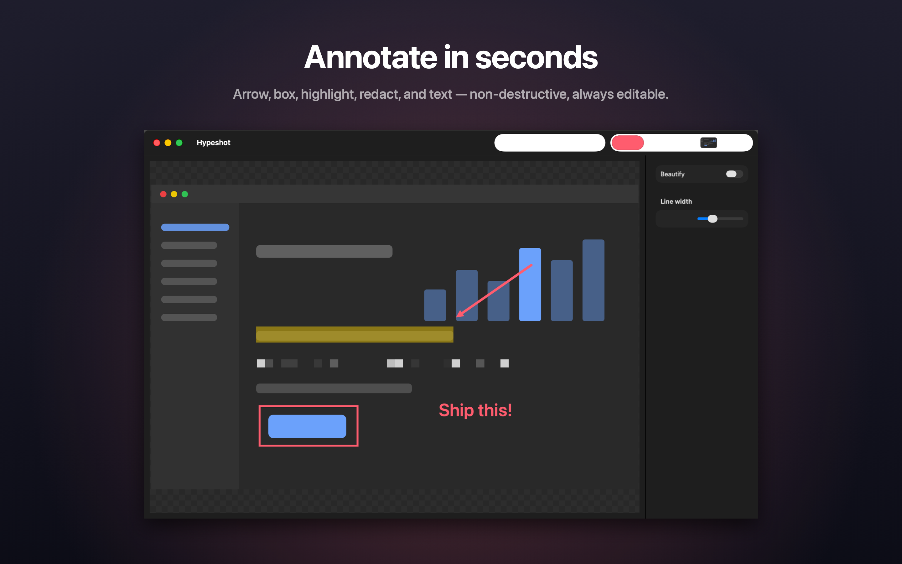
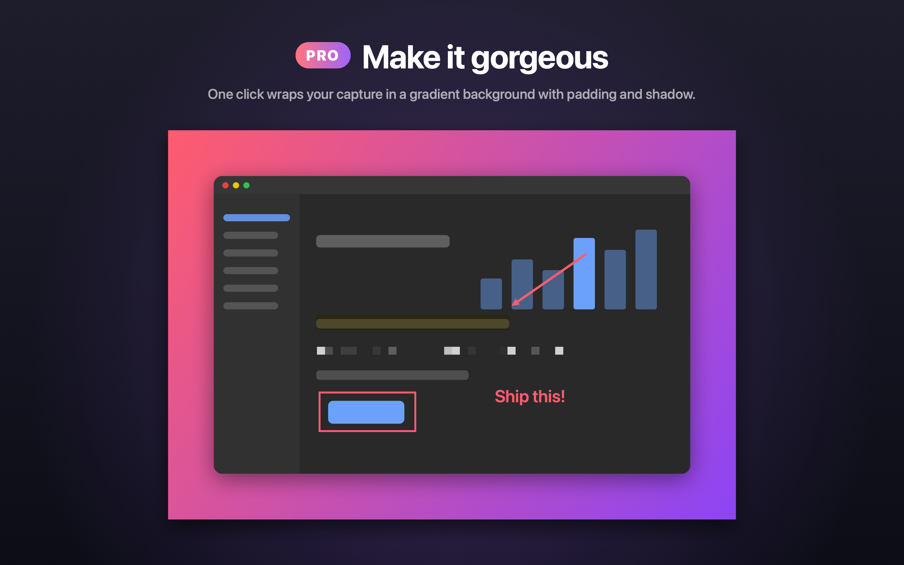

# Hypeshot

**Native macOS screenshot tool that lives in your menu bar. Capture, annotate, beautify. Swift, offline, no account, no subscription, no telemetry.**

Press ⇧⌘7, drag over what you want, and the capture opens in a focused editor. Mark it up, copy it, get back to work.



## Why another screenshot app

The good Mac screenshot tools are closed source and paid. The free ones are closed source too. Hypeshot is the one you can read: one Swift target, about 2,700 lines, ScreenCaptureKit for capture, SwiftUI Canvas for annotation, Vision for on-device OCR. Nothing leaves your Mac. There is no server to shut down.

## Features

**Free, in this repository and on the Mac App Store**

- Area, window, and full-screen capture with global shortcuts (⇧⌘7 / ⇧⌘8 / ⇧⌘9), all re-mappable
- Pixel-accurate selection with live dimensions; window picker highlights exactly what you get
- Annotation editor: arrows, boxes, ellipses, highlights, text, and a pixelate tool for redacting secrets
- Non-destructive: every annotation stays editable, undo anything
- Copy to clipboard automatically, save as PNG or JPEG, drag straight into Slack or Figma
- Choose a save folder once, optionally auto-save every capture
- Launch at login, no Dock icon, lives entirely in the menu bar

**Pro, one purchase on the Mac App Store, $7.99, no subscription**

- Beautify: gradient backgrounds, padding, rounded corners, shadow. Social-ready in one click
- Pinned screenshots: float any capture above your windows while you work from it
- Capture history: every screenshot kept and browsable
- Copy Text (OCR) with Apple's on-device Vision framework
- Export presets: formats, scales, and filename templates, remembered



## Install

Requires macOS 26 Tahoe. Apple silicon and Intel.

**Mac App Store** (free app, Pro inside): [Hypeshot Pro](https://apps.apple.com/app/hypeshot-pro/id6787453009?mt=12)

**Direct download:** the `.dmg` on the [Releases](https://github.com/shafidgl/Hypeshot/releases) page. Signed and notarized. Drag Hypeshot to Applications, launch, grant Screen Recording when asked, then relaunch (macOS applies the grant at launch).

**Homebrew:**

```sh
brew install --cask shafidgl/tap/hypeshot
```

**Build it yourself:**

```sh
brew install xcodegen
git clone https://github.com/shafidgl/Hypeshot.git && cd Hypeshot
xcodegen generate
xcodebuild -scheme Hypeshot -destination 'platform=macOS' build
```

The source is complete, including every Pro feature. Build with `SWIFT_ACTIVE_COMPILATION_CONDITIONS=FORCE_PRO` and everything is unlocked. If you can build it, it is yours. The $7.99 on the App Store pays for the signed, notarized, auto-updating build and for the next feature.

## How it compares

| | Hypeshot | CleanShot X | Shottr | macOS built-in |
|---|---|---|---|---|
| Open source | Yes, MIT | No | No | No |
| Price | Free; Pro $7.99 once | From $29 | Free, paid license for some features | Free |
| Annotations | Yes, non-destructive | Yes | Yes | Basic |
| Redact (pixelate) | Yes | Yes | Yes | No |
| Beautify backgrounds | Pro | Yes | Partial | No |
| OCR | Pro, on-device | Yes | Yes | Live Text |
| Pinned screenshots | Pro | Yes | Yes | No |
| Cloud upload | No, by design | Subscription | No | No |
| Telemetry | None | Some | None | n/a |
| Sandboxed | Yes | No | No | Yes |

Prices and features of other apps as of November 2026; check their sites.

## Privacy

Sandboxed. Works entirely on your Mac. No account, no network calls, no analytics, no crash reporting. OCR runs on-device. The only permission it asks for is Screen Recording, which is what a screenshot app is.

## Shortcuts

| Action | Default |
|---|---|
| Capture area | ⇧⌘7 |
| Capture window | ⇧⌘8 |
| Capture full screen | ⇧⌘9 |

Change any of them in Settings.

## Project layout

```
Hypeshot/
  CaptureEngine.swift     ScreenCaptureKit capture and permission handling
  SelectionOverlay.swift  Area and window selection UI
  EditorWindow.swift      Annotation editor (SwiftUI Canvas)
  Renderer.swift          Flattens annotations and Beautify into the output image
  Exporter.swift          PNG/JPEG export, presets, filename templates
  HistoryStore.swift      Capture history (Pro)
  PinWindow.swift         Floating pinned screenshots (Pro)
  OCRService.swift        Vision text recognition (Pro)
  HotkeyManager.swift     Global shortcuts and recorder
  ProStore.swift          StoreKit 2 entitlement; direct builds point to the App Store
HypeshotTests/            Unit tests (models, renderer pixels, exporter, history, OCR, StoreKit)
Tools/release-direct.sh   Builds the signed, notarized DMG for GitHub releases
project.yml               XcodeGen spec; the .xcodeproj is generated from it
```

Build configurations: `Debug` and `Release` are the App Store builds with StoreKit. `Direct` (scheme `Hypeshot-Direct`) is the GitHub build: hardened runtime, no StoreKit, the paywall links to the App Store.

## Contributing

Issues and pull requests are welcome. Run the tests before opening a PR:

```sh
xcodebuild -scheme Hypeshot -destination 'platform=macOS,arch=arm64' test
```

## License

MIT. See [LICENSE](LICENSE). The Hypeshot name and icon are not covered by the license; forks need their own name and icon.

Made in Dubai by [Mohamed Shafi](https://hypecode.app).
